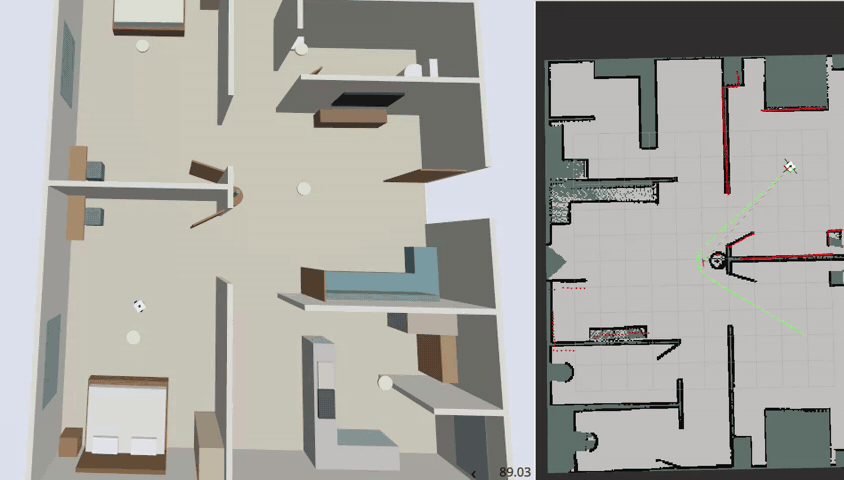
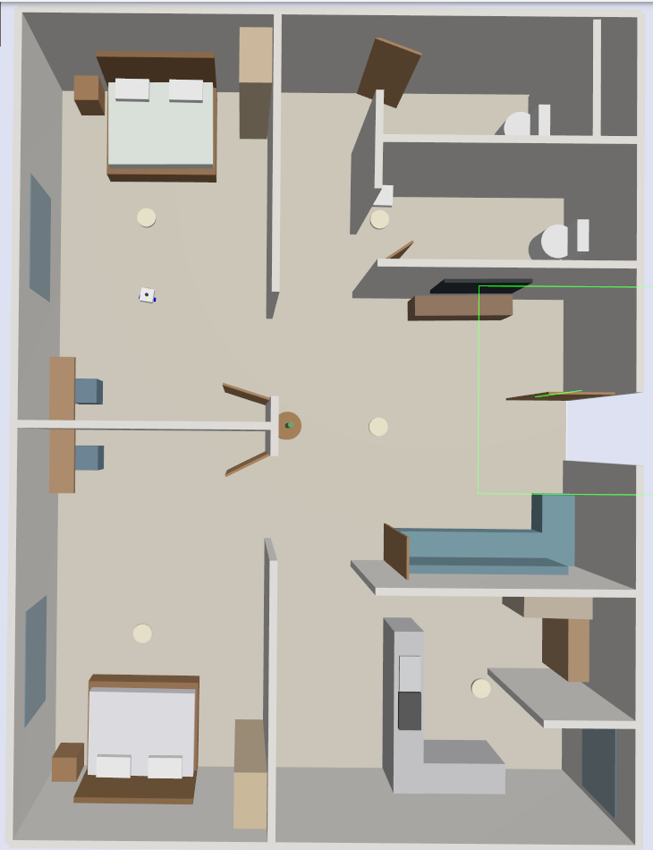
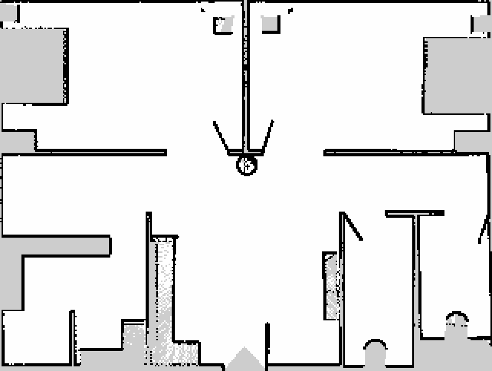
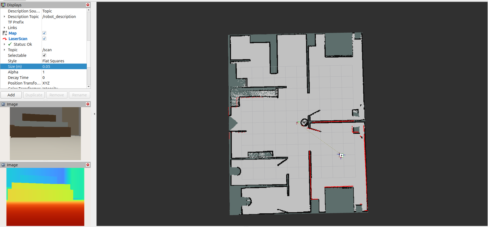
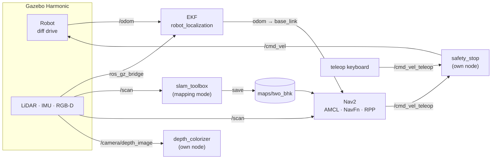

# PRISM — Floor-Plan-Guided Semantic Navigation (ROS 2)

**Plan from floor plan · Refine with SLAM · Identify objects · Move semantically**


A ROS 2 Jazzy + Gazebo Harmonic indoor robot that is being built to navigate a home on its
**very first run using only a floor-plan image**, while SLAM corrects the map live and an RGB-D
perception layer labels objects for semantic goals ("go to kitchen", "find the chair").

**Today** the robot maps a furnished 2BHK house with SLAM and drives autonomously between rooms
with Nav2, behind its own LiDAR safety layer.

<p align="center">
  
  <br>
  <em>Autonomous navigation (2× speed). Left: Gazebo simulation. Right: RViz — SLAM map,
  live LiDAR scan (red) and the planned path (green).
  <a href="docs/media/nav2_demo.mp4">MP4 version</a></em>
</p>

---

## Contents

- [What works today](#what-works-today)
- [Gallery](#gallery)
- [System architecture](#system-architecture)
- [Quick start](#quick-start)
- [How navigation works](#how-navigation-works)
- [Safety stop](#safety-stop)
- [Topics](#topics)
- [Repository layout](#repository-layout)
- [Engineering notes](#engineering-notes)
- [Roadmap](#roadmap)
- [Tests and troubleshooting](#tests)

## What works today

| Module | Status |
|---|---|
| Differential-drive robot (URDF/xacro) in a furnished 2BHK world | ✅ Done |
| Sensor suite: 360° 2D LiDAR, IMU, RGB-D camera, wheel encoders | ✅ Done |
| Depth colorizer node (TURBO colormap, Python/OpenCV) | ✅ Done |
| EKF state estimation (wheel odometry + IMU yaw rate) | ✅ Done |
| LiDAR safety stop with dead-man timeout | ✅ Done |
| SLAM mapping (slam_toolbox) + saved map | ✅ Done |
| Nav2 navigation (AMCL + NavFn + Regulated Pure Pursuit) | ✅ Done |
| Floor plan → room/door graph → Nav2 waypoints (C++) | ⏳ Next |
| YOLOv8 + depth semantic mapping ("find the chair") | ⏳ Planned |

## Gallery

| Simulated 2BHK home (Gazebo) | Map built with SLAM | Navigation view (RViz) |
|:---:|:---:|:---:|
|  |  |  |
| Bedrooms, hall, kitchen, bathrooms and furniture | `maps/two_bhk` — 16 × 12 m at 5 cm/pixel | Robot localized on the map; LiDAR (red) matches the walls; RGB and colourized depth images on the left |

## System architecture



Every velocity command — from the keyboard or from Nav2 — passes through `safety_stop`
before it reaches the robot, so the safety layer always has the last word.

## Quick start

### Install

Tested on Ubuntu 24.04 with ROS 2 Jazzy and Gazebo Harmonic.

```bash
mkdir -p ~/ros2_ws/src && cd ~/ros2_ws/src
git clone https://github.com/akashakhade/prism-floorplan-nav.git mobile_robot
cd ~/ros2_ws
rosdep install --from-paths src --ignore-src -r -y
colcon build --symlink-install --packages-select mobile_robot
source install/setup.bash
```

### 1. Simulation (always first)

```bash
ros2 launch mobile_robot launch_sim.launch.py
```

Drive manually (new terminal) — **hold** the key to keep moving:

```bash
ros2 run teleop_twist_keyboard teleop_twist_keyboard --ros-args -r cmd_vel:=cmd_vel_teleop
```

### 2. Autonomous navigation (uses the saved map)

```bash
ros2 launch mobile_robot nav2.launch.py
```

Wait for `Managed nodes are active`, then click **2D Goal Pose** in RViz (Fixed Frame = `map`).
The robot starts at the map origin, so no initial pose is needed. Or send a goal from a terminal:

```bash
ros2 action send_goal /navigate_to_pose nav2_msgs/action/NavigateToPose \
  "{pose: {header: {frame_id: map}, pose: {position: {x: -1.0, y: 0.0}, orientation: {w: 1.0}}}}"
```

### 3. Make a new map (optional)

Start SLAM right after the simulation, **before the robot moves**, so the map origin is the
spawn point:

```bash
ros2 launch mobile_robot slam.launch.py
# drive slowly through every room with teleop, then:
ros2 run nav2_map_server map_saver_cli -f ~/ros2_ws/src/mobile_robot/maps/two_bhk \
  --ros-args -p use_sim_time:=true
```

## How navigation works

| Layer | Component | What it does |
|---|---|---|
| Map | slam_toolbox → `maps/two_bhk` | Occupancy grid of the house (walls, free space) |
| Localization | AMCL | Particle filter that matches the LiDAR scan to the map: *where am I?* |
| Global planning | NavFn (Dijkstra) on the global costmap | Shortest safe path from the robot to the goal, through doors |
| Local control | Regulated Pure Pursuit on a 3 × 3 m rolling costmap | Follows the path, slows down in turns and near obstacles |
| Safety | Collision monitor + `safety_stop` | Last-moment braking based on live LiDAR |

Settings tuned for this robot (`config/nav2_params.yaml`): rectangular 0.35 × 0.40 m footprint,
0.35 m inflation (doorways stay passable), max 0.4 m/s, EKF odometry, and Regulated Pure Pursuit
instead of MPPI to keep CPU load low.

Command chain:

```
Nav2 controller → velocity_smoother → collision_monitor → /cmd_vel_teleop → safety_stop → /cmd_vel → Gazebo
```

## Safety stop

`mobile_robot/safety_stop.py` filters every velocity command using the LiDAR:

- slows down when an obstacle is within 0.70 m and stops at 0.35 m (front), 0.30 m (rear)
- **dead-man switch:** no command for 1 s → full stop (a crashed teleop or Nav2 cannot run away)
- no LiDAR scan for 0.5 s → forward/backward motion blocked
- invalid parameters are rejected at startup

## Topics

| Topic | Type | Source |
|---|---|---|
| `/scan` | LaserScan | 360° GPU LiDAR @ 10 Hz |
| `/imu` | Imu | IMU @ 50 Hz |
| `/camera/image`, `/camera/depth_image`, `/camera/points` | Image / PointCloud2 | RGB-D camera 320×240 @ 10 Hz |
| `/camera/depth_colored` | Image | depth_colorizer node |
| `/odom`, `/joint_states` | Odometry / JointState | Diff-drive + encoders |
| `/odometry/filtered` + TF `odom → base_link` | Odometry / TF | EKF (robot_localization) |
| `/map` + TF `map → odom` | OccupancyGrid / TF | map_server + AMCL (or slam_toolbox while mapping) |
| `/plan` | Path | Nav2 global planner |
| `/cmd_vel_teleop` | Twist | Teleop or Nav2 (unfiltered) |
| `/cmd_vel` | Twist | safety_stop (LiDAR-filtered) → Gazebo |

## Repository layout

```
├── config/        EKF, SLAM and Nav2 parameters, RViz layouts
├── description/   robot URDF/xacro: chassis, LiDAR, IMU, RGB-D camera, Gazebo plugins
├── launch/        launch_sim, slam, nav2, display, rsp
├── maps/          saved SLAM map (two_bhk.pgm / .yaml)
├── mobile_robot/  Python nodes: safety_stop, depth_colorizer
├── worlds/        furnished 2BHK Gazebo world
├── docs/media/    README images and demo video
└── test/          flake8 / pep257 / copyright linters
```

## Engineering notes

Things that took the most debugging, kept here for anyone hitting the same issues:

- **Simulation ran at ~13 % real time.** Causes: a 1 ms physics step (the bridge had to forward
  1000 clock messages per second) and old Gazebo servers still running in the background.
  Fix: 4 ms physics step, no shadows, lighter camera (320×240 @ 10 Hz) and IMU (50 Hz), and
  `pkill -f "gz sim"` between runs → **~85–95 % real time** on an integrated GPU.
- **Double walls in the SLAM map.** Fast turns in tight rooms bent the scans. Driving slower,
  turning in larger rooms and closing the loop at the start gave a clean map.
- **Nav2 stayed inactive.** The planner waits until AMCL knows the robot's pose. Starting SLAM at
  the spawn point puts the spawn at the map origin, so `set_initial_pose: true` at (0, 0) makes
  start-up fully automatic.
- **"Ghost" doors.** Door models with a visual but no collision were seen by the GPU LiDAR as
  walls, while the robot could drive through them. Closed ghost doors were removed from the world.

## Roadmap

1. **Floor plan → room/door graph (C++)** — rooms as nodes, doors as edges; `go to kitchen`
   becomes a sequence of Nav2 waypoints.
2. **Graph from a floor-plan image** — build the room graph automatically so the robot can
   navigate a new home on its first run, with SLAM correcting the differences live.
3. **YOLOv8 + depth semantic map** — detect objects (chair, bed, fridge) and place them on the map
   for goals like `find the chair`.
4. **Evaluation** — first-run success rate, time and path length with vs. without the floor plan.

## Tests

```bash
colcon test --packages-select mobile_robot && colcon test-result --verbose
```

## Troubleshooting

- **Simulation slow / robot jerky:** a previous Gazebo server may still be running in the
  background. After stopping the launch, run `pkill -f "gz sim"`.
- **Build error after deleting a file** (`can't copy ... doesn't exist`):
  `rm -rf build/mobile_robot install/mobile_robot` and build again.
- **`Package 'mobile_robot' not found`:** run `source ~/ros2_ws/install/setup.bash` in that terminal.
- **Nav2 nodes stay `inactive`:** the robot has no pose on the map yet — check that the simulation
  was started fresh (robot at its spawn point) or set one with **2D Pose Estimate** in RViz.
- **Robot does not move while driving with the keyboard:** teleop must publish to
  `/cmd_vel_teleop` (see the command above), and keys must be held, not tapped.

## Author

**Akash Akhade** — B.E. Computer Engineering · [GitHub](https://github.com/akashakhade)

Feedback and suggestions are welcome — feel free to open an issue.
